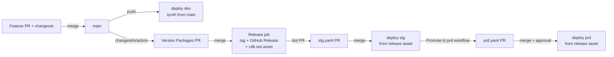

# Design: Manifest-Driven CDK Deployments Demo

Status: Draft
Date: 2026-11-23
Spec: [SPEC.md](SPEC.md)

## Summary

`main` is the only long-lived branch. Changesets turn merged PRs into SemVer releases. Each release synthesizes the CDK app once and attaches the cloud assembly (`cdk.out`) to the GitHub Release. `stg` and `prd` deploy that assembly with `cdk deploy --app <assembly>`, choosing the version from `environments/<env>.yaml`. `dev` synthesizes and deploys from `main` on every push.

## Flow



## Repo layout

```
.nvmrc                       # 24
package.json                 # packageManager: pnpm@10.x, root scripts
pnpm-workspace.yaml
.changeset/
  config.json
apps/demo/                   # package name: demo-app (private)
  package.json
  CHANGELOG.md
  bin/app.ts                 # instantiates dev/stg/prd stages
  lib/demo-stage.ts
  lib/demo-stack.ts
  lib/environments.ts        # account, region per env
  lambda/handler.ts
  cdk.json
environments/
  manifest.schema.json
  stg.yaml
  prd.yaml
scripts/
  read-manifest.ts           # prints version for an env
  check-manifest.ts          # PR check for manifest changes
  fetch-assembly.ts          # downloads + verifies release asset
.github/
  CODEOWNERS
  workflows/
    ci.yml
    release.yml
    deploy.yml               # reusable (workflow_call)
    deploy-dev.yml
    deploy-stg.yml
    deploy-prd.yml
    promote-prd.yml
docs/
```

## Toolchain

- `.nvmrc` holds `24`. Locally: `nvm use`. In CI: `actions/setup-node` with `node-version-file: .nvmrc`.
- `packageManager: "pnpm@10.x.y"` in root `package.json`. CI uses `pnpm/action-setup`, which reads that field. Locally: `corepack enable`.
- `pnpm install --frozen-lockfile` everywhere in CI.
- `aws-cdk` (CLI) and `aws-cdk-lib` are dev dependencies of `apps/demo`. CI runs `pnpm cdk`, never a global CLI.

## CDK app

One stack per environment, wrapped in a `Stage`:

| Stage | Stack name | Account / region |
| --- | --- | --- |
| `dev` | `demo-dev` | from `lib/environments.ts` |
| `stg` | `demo-stg` | from `lib/environments.ts` |
| `prd` | `demo-prd` | from `lib/environments.ts` |

The stack contains:

- A Node.js Lambda (`NodejsFunction`, esbuild bundled) with a Function URL, auth `NONE`.
- The Lambda returns JSON: `{ app, version, environment, gitSha, builtAt }`. `GET /` returns a small HTML page showing the same.
- Stack outputs: `Url`, `Version`.
- Tags on all resources: `app=demo-app`, `version=<version>`, `environment=<env>`.

The version is resolved at synth time:

- Release synth: `version` from `apps/demo/package.json`.
- Dev synth: `<package version>+main.<short sha>`.

The CDK app takes `version` and `gitSha` as context (`-c version=... -c gitSha=...`). It does no context lookups, so synth needs no AWS credentials and a release assembly stays valid for every environment.

All three stages are synthesized into one assembly. Deploys select a stage with a stack pattern, e.g. `pnpm cdk deploy --app ./cdk.out 'stg/*'`.

## Versioning and release

`.changeset/config.json`:

```json
{
  "changelog": ["@changesets/changelog-github", { "repo": "<owner>/<repo>" }],
  "commit": false,
  "access": "restricted",
  "baseBranch": "main",
  "privatePackages": { "version": true, "tag": true }
}
```

`demo-app` is `private: true`. `changeset tag` creates `demo-app@<version>` tags without publishing to npm.

`release.yml` runs on push to `main`:

1. `changesets/action` with `version: pnpm changeset version` and `publish: pnpm changeset tag`.
   - With pending changesets: opens or updates the Version Packages PR.
   - After that PR merges: runs `changeset tag`, pushes the tag, creates the GitHub Release.
2. If `published == 'true'`:
   - Check out the new tag.
   - `pnpm cdk synth -c version=<v> -c gitSha=<sha>`.
   - Package `cdk.out` as `demo-app-<v>-cdk.out.tar.gz` and write `.sha256`.
   - `gh release upload demo-app@<v>` with both files.
   - Open a PR setting `environments/stg.yaml` to `<v>`.

Tokens: tags, PRs and releases created with `GITHUB_TOKEN` do not trigger other workflows. The release workflow uses a GitHub App token (`actions/create-github-app-token`) so the Version Packages PR and the stg PR run CI.

## Manifest

```yaml
# yaml-language-server: $schema=./manifest.schema.json
app: demo-app
version: 1.3.0
```

- `version` is an exact SemVer string. No ranges, no `latest`.
- The schema rejects anything else. `check-manifest.ts` validates against it.
- One file per environment keeps PR diffs small and lets CODEOWNERS differ per environment.

## Workflows

### `ci.yml` (pull_request)

- Install, lint, typecheck, unit test, `cdk synth`.
- `changeset status --since=origin/main` fails when app code changed without a changeset.
- If `environments/**` changed: run `check-manifest.ts` (below).

### `deploy.yml` (reusable)

Inputs: `environment`, `version` (empty for dev).

```yaml
jobs:
  deploy:
    runs-on: ubuntu-latest
    environment:
      name: ${{ inputs.environment }}
      url: ${{ steps.deploy.outputs.url }}
    concurrency:
      group: deploy-${{ inputs.environment }}
      cancel-in-progress: false
    permissions:
      id-token: write
      contents: read
```

Steps:

1. Checkout. For a released version, check out tag `demo-app@<version>` so the CDK CLI matches the assembly.
2. Setup Node from `.nvmrc`, pnpm, `pnpm install --frozen-lockfile`.
3. Get the assembly:
   - dev: `pnpm cdk synth` with the `+main.<sha>` version.
   - stg/prd: `fetch-assembly.ts` downloads the release asset and verifies the checksum.
4. `aws-actions/configure-aws-credentials` with `role-to-assume: ${{ vars.AWS_ROLE_ARN }}`.
5. `pnpm cdk deploy --app ./cdk.out '<env>/*' --require-approval never --outputs-file outputs.json`.
6. Smoke check: `curl` the `Url` output and assert `version` matches.
7. Write a job summary: environment, version, URL, link to release notes.

### `deploy-dev.yml`

Push to `main`, `paths-ignore: [environments/**, docs/**, '**.md']`. Calls `deploy.yml` with `environment: dev`.

### `deploy-stg.yml` / `deploy-prd.yml`

Push to `main` with `paths: [environments/<env>.yaml]`, plus `workflow_dispatch`. Read the version with `read-manifest.ts`, then call `deploy.yml`.

### `promote-prd.yml` (workflow_dispatch)

Reads the version from `environments/stg.yaml`, writes it to `environments/prd.yaml`, opens a PR. The PR body includes the changelog between current `prd` and the new version.

## Manifest PR check

`check-manifest.ts` runs for each changed manifest:

1. Validate against the schema.
2. Confirm GitHub Release `demo-app@<version>` exists and has the assembly asset.
3. For `prd` only:
   - Fetch the live `stg` and `prd` URLs (from GitHub Environment variables `APP_URL`) and read `version`.
   - Pass if target == live `stg` version.
   - Pass if target < live `prd` version (rollback). Label the PR summary as a rollback.
   - Fail otherwise.
4. Post a sticky PR comment: current version, target version, changelog excerpt.

Reading the live endpoints needs no AWS credentials, so the check runs in PR CI. The trade-off: it checks what is running now, not deploy history.

## GitHub Environments

| Environment | Deployment branches | Protection | Variables |
| --- | --- | --- | --- |
| `dev` | `main` | none | `AWS_ROLE_ARN`, `APP_URL` |
| `stg` | `main` | none | `AWS_ROLE_ARN`, `APP_URL` |
| `prd` | `main` | required reviewers | `AWS_ROLE_ARN`, `APP_URL` |

Required reviewers on a private repo need GitHub Team or Enterprise. A public repo works on the free plan.

`APP_URL` is set once after the first deploy. A later change could have the deploy job update it.

## AWS access

- One GitHub OIDC provider per account.
- One deploy role per environment. Trust policy condition:
  `token.actions.githubusercontent.com:sub = repo:<owner>/<repo>:environment:<env>`.
- The role can assume the CDK bootstrap roles (`cdk-hnb659fds-*`) in its account. Nothing else.
- Each account/region is bootstrapped once with `cdk bootstrap`, trusting nothing beyond its own account.
- A `bootstrap/` CDK or CloudFormation template for the OIDC provider and roles is documented but run by hand.

## Rollback

Open a PR setting the manifest to an older version. The check passes (rollback rule), the deploy job fetches the old release asset and deploys it. No rebuild.

Release assets are never deleted. GitHub keeps them for the life of the release.

## Failure modes

| Failure | Result |
| --- | --- |
| Release job fails after tagging, before upload | Release exists without asset. Manifest check fails. Re-run the upload job from the tag. |
| Deploy fails mid-way | CloudFormation rolls back the stack. Manifest on `main` now names a version not running. Fix forward or revert the manifest PR. |
| Two manifest PRs merge quickly | Concurrency group queues the second deploy. Last merge wins. |
| Smoke check fails | Job fails. Stack is already updated. Revert the manifest PR to roll back. |
| CDK CLI on `main` too old for an assembly | Avoided by checking out the release tag before deploy. |

## Alternatives considered

- **Deploy from tag with a fresh synth.** Simpler: no release asset. Rejected because esbuild output is not guaranteed reproducible, so `stg` and `prd` could run different bytes.
- **Single manifest file for all environments.** One file is easier to read. Rejected because every promotion touches the same file, and per-environment CODEOWNERS is harder.
- **Branch per environment (`release/stg`, `release/prd`).** Common pattern. Rejected: it hides what is deployed in branch state instead of a file, and needs merge-down discipline.
- **Version in SSM, read by the pipeline.** Moves the source of truth out of git. Rejected: no PR review or history.
- **Deploy history via the GitHub Deployments API for the prd check.** More accurate than reading live endpoints. Deferred: Actions-created deployments reference the workflow commit, not the release tag, so it needs extra bookkeeping.

## Open questions

- Accounts: one shared account (simplest demo) or three (closer to real use)? `lib/environments.ts` supports either.
- Should `stg` auto-deploy on release instead of via a bot PR?
- Add a second component to show a manifest pinning several versions? The manifest would become `components: { demo-app: 1.3.0, other: 0.4.1 }`.
- Should the deploy job update `APP_URL` itself? It needs a token with environment variable write access.
